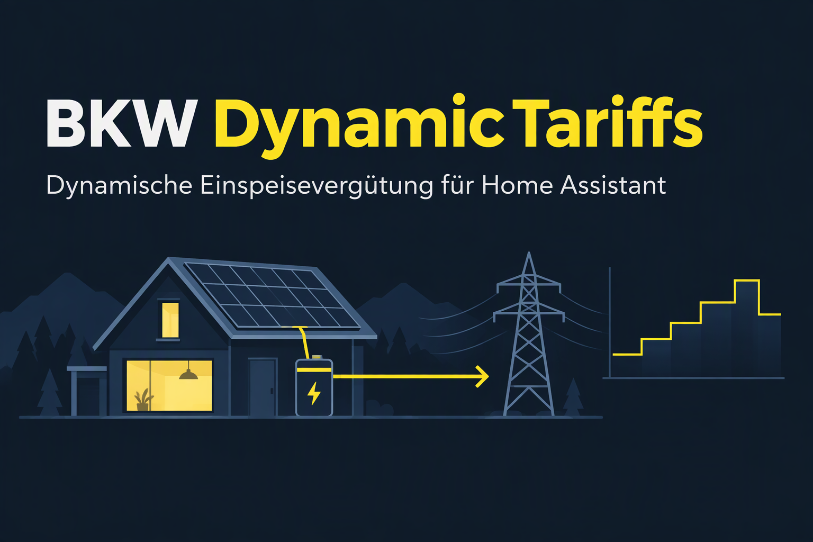

# BKW Dynamic Tariffs



Die dynamische **Einspeisevergütung der BKW** in Home Assistant: aktuelle Preise,
Tagesstatistiken und konfigurierbare Preisschwellen für deine Automationen.

**Kein Bezugstarif.** Hohe Werte bedeuten eine höhere Vergütung für eingespeisten
Strom, nicht teureren Netzbezug. Die Integration steuert selbst keine Geräte.

Unabhängige Community-Integration; nicht offiziell von BKW oder Home Assistant.
Mindestversion: **Home Assistant 2026.11.0**. Keine Zugangsdaten oder API-Schlüssel.

<!-- ha-marketplace:exclude-start -->
[](https://my.home-assistant.io/redirect/marketplace_repository/?owner=lukirenggli&repository=hass-bkw-dynamic-tariffs&category=integration)

## Installation im Marketplace

Ab Home Assistant 2026.11 ist der Marketplace integriert. **HACS nicht separat installieren.**

Solange dieses Projekt noch nicht im Standardkatalog gelistet ist:

1. Als Administrator **Einstellungen > Marketplace** öffnen und den Sicherheitshinweis lesen.
2. **Aus Link hinzufügen / Add from link** auswählen.
3. `https://github.com/lukirenggli/hass-bkw-dynamic-tariffs` eingeben.
4. Falls gefragt, GitHub verbinden; Typ **Integration** auswählen.
5. **BKW Dynamic Tariffs** öffnen und installieren. Einen angeforderten Neustart ausführen.
6. Den anschliessenden Einrichtungsdialog ausfüllen. Alternativ unter
   **Einstellungen > Geräte & Dienste > Integration hinzufügen** nach dem Namen suchen.

Nach Aufnahme in den Katalog genügt die Suche nach **BKW Dynamic Tariffs** im Marketplace.

### Manuelle Installation

Den Ordner `custom_components/bkw_dynamic_tariffs` in den gleichnamigen Ordner
innerhalb deiner Home-Assistant-Konfiguration kopieren. Home Assistant neu starten,
dann die Integration unter **Geräte & Dienste** hinzufügen. Das ZIP des gesamten
Repositories ist **kein** Add-on/App-Archiv und wird nicht in Home Assistant hochgeladen.
<!-- ha-marketplace:exclude-end -->

## Konfiguration

| Einstellung | Einheit | Beispiel / Startwert |
|---|---|---|
| Preisschwelle oben | CHF/kWh | 0.150 |
| Preisschwelle unten | CHF/kWh | 0.050 |

Die Startwerte sind Beispiele, keine Empfehlungen. Negative Schwellen sind erlaubt.
Der Bereich ist -10 bis 10 CHF/kWh, die Eingabeschrittweite 0.001 CHF/kWh.
Die untere Schwelle darf die obere nicht übersteigen. Beide Werte können über die
Zahlen-Entitäten im Bereich **Konfiguration** oder gemeinsam über die Optionen der
Integration geändert werden. Sie werden dauerhaft in Home Assistants Config Entry
gespeichert und gelten sofort, ohne API-Abruf oder Neuladen.

**Einheiten beachten:** 0.050 CHF/kWh entspricht 5 Rp./kWh. API-Werte werden nicht
mit 100 multipliziert. Mindestvergütungsprämien und andere Abrechnungsbestandteile
werden nicht ergänzt; dargestellt wird ausschliesslich das Feld `feed_in` der API.

## Entitäten

Alle Entitäten gehören zum Gerät **BKW Dynamic Tariffs**. Namen werden auf Deutsch
oder Englisch angezeigt. Home Assistant vergibt die tatsächlichen Entity-IDs;
verwende in Dashboards und Automationen die IDs deiner Installation.

| Entität | Typ | Bedeutung |
|---|---|---|
| Aktueller Preis | Sensor, CHF/kWh | Preis des jetzt gültigen Zeitintervalls |
| Durchschnittspreis heute | Sensor, CHF/kWh | Zeitgewichteter Mittelwert des vollständigen heutigen Plans |
| Maximaler Preis heute | Sensor, CHF/kWh | Höchster Preis im vollständigen heutigen Plan |
| Minimaler Preis heute | Sensor, CHF/kWh | Tiefster Preis im vollständigen heutigen Plan |
| Nächster Preiswechsel | Sensor, min | Aufgerundete Minuten bis zum nächsten bekannten anderen Preis |
| Über oberer Preisschwelle | Binary Sensor | `on`, wenn der aktuelle Preis strikt über der oberen Schwelle liegt |
| Unter unterer Preisschwelle | Binary Sensor | `on`, wenn der aktuelle Preis strikt unter der unteren Schwelle liegt |
| Tarife aktualisieren | Button, Konfiguration | Zusätzlichen API-Abruf auslösen |
| Preisschwelle oben | Number, Konfiguration | Obere Schwelle dauerhaft ändern |
| Preisschwelle unten | Number, Konfiguration | Untere Schwelle dauerhaft ändern |
| Letzte API-Aktualisierung | Sensor, Diagnose | Zeitpunkt des letzten erfolgreich übernommenen API-Abrufs |

Bei Gleichheit mit einer Schwelle ist der entsprechende Binary Sensor `off`.
Es gibt keine Hysterese. In Home Assistant erscheinen boolesche Entitäten als `on/off`.

### Preiswechsel und Attribute

Gleich teure, direkt aufeinanderfolgende Intervalle werden für den Countdown
zusammengefasst. Ein Wechsel in 30 Sekunden ergibt 1 Minute. Das Ende des
veröffentlichten Plans oder eine Datenlücke ist **kein bekannter Preiswechsel**:
der Countdown ist dann `unavailable`, während der aktuelle Preis noch gültig sein kann.

- Aktueller Preis: `interval_start`, `interval_end`, `prices` (bekannter Plan mit
  `start`, `end`, `price`), `publication_timestamp`, `last_api_success`.
- Nächster Preiswechsel: `next_change_at` als ISO-Zeitstempel.
- Tagesstatistiken: `date`, `timezone`, `complete`, `coverage_percent`,
  `covered_minutes`, `expected_minutes`, `slots_count`.
- Binary Sensor: `threshold`, `price_unit`, `comparison`.

## Aktualisierung und Datenqualität

- **Netzwerk:** ein Abruf beim Einrichten zur API-Prüfung, ein Abruf beim Laden
  der Integration (auch nach Neustart), danach alle **12 Stunden**.
- **Manuell:** der Button und die Home-Assistant-Aktion `homeassistant.update_entity`
  können zusätzliche Abrufe auslösen. Der Coordinator bündelt schnelle Anfragen
  mit einem kurzen Debounce. Ein manueller Abruf setzt den 12-Stunden-Timer neu.
- **Lokal:** Sensoren werden an Minuten- und Intervallgrenzen aus dem gespeicherten
  Plan neu berechnet. Dabei erfolgt **kein** API-Abruf. Mitternacht aktualisiert die
  Tagesstatistiken ebenfalls lokal.
- **Kalendertag:** heute wird stets in `Europe/Zurich` berechnet, unabhängig von der
  Zeitzone der Home-Assistant-Installation. Sommer-/Winterzeit wird berücksichtigt.
- **Durchschnitt:** nach Intervalllänge gewichtet; kein produktionsgewichteter oder
  individuell erzielter Vergütungsdurchschnitt.
- **Fehlende Intervalle:** kein Nullwert, kein Fortführen des alten Preises. Aktueller
  Preis und Binary Sensoren sind in Lücken `unavailable`. Tagesmittel, Tagesminimum
  und Tagesmaximum sind nur bei 100 % Tagesabdeckung verfügbar.
- **API-Fehler:** noch gültige, bereits geladene Preise bleiben nutzbar. Die Attribute
  zeigen `last_api_success: false`. Abgelaufene Intervalle werden nicht verlängert.
- **Cache:** nur im Arbeitsspeicher, nicht dauerhaft auf Festplatte. Neue Antworten
  ersetzen ihren Zeitraum einschliesslich Lücken; geladene andere Tage bleiben erhalten.
- **Ungültige Antworten:** falsche Einheiten, fehlende Preise, nicht-endliche Zahlen,
  Zeitzonenfehler oder überlappende Intervalle verwerfen die neue Antwort. Ein
  zurückgesetzter Publikationszeitstempel überschreibt keinen neueren Plan.

### Grenze des 12-Stunden-Intervalls

Der dokumentierte Endpunkt akzeptiert **keine Query-Parameter**. Es kann deshalb
kein Datum für morgen angefordert werden. Die API garantiert in der geprüften
Spezifikation keine durchgehende Vorschau über die nächsten 12 Stunden.
Wenn noch keine Folgepreise vorhanden sind, können bis zum nächsten Abruf Lücken
entstehen. Es gibt absichtlich **keinen zusätzlichen automatischen Abruf** bei
Mitternacht oder Datenende. Bei Bedarf **Tarife aktualisieren** drücken.

## Automation sicher verwenden

Beispiel im visuellen Automationseditor: Beim Wechsel von **Über oberer
Preisschwelle** von `off` auf `on` eine Benachrichtigung auslösen. Bei tiefer
Einspeisevergütung kann **Unter unterer Preisschwelle** als Bedingung für mehr
Eigenverbrauch dienen. Ob Speicherung oder Abregelung sinnvoll ist, hängt von
deiner Anlage ab.

**Wichtig:** `unavailable` oder `unknown` ist nicht gleich Preis null. Automationen
müssen fehlende Daten ausdrücklich behandeln und einen sicheren Gerätezustand
haben. Prüfe zunächst mit Benachrichtigungen, bevor Geräte gesteuert werden.

## Diagnose und Probleme

- Einrichtung scheitert: Internetzugang zu `api.bkw.ch`, HTTP-Status und Logs prüfen.
- Aktueller Preis fehlt: `prices`, Intervallgrenzen und Datenlücken prüfen; Refresh drücken.
- Tagesstatistik fehlt: `coverage_percent` muss 100 sein; eine Lücke ist kein Bug.
- Schwellenänderung abgelehnt: zuerst die obere erhöhen bzw. die untere senken,
  oder beide gemeinsam im Optionsdialog setzen.
- Diagnose herunterladen: Integration unter **Geräte & Dienste** öffnen.
- Fehler melden: [Issues](https://github.com/lukirenggli/hass-bkw-dynamic-tariffs/issues).
  HA-Version, Integrationsversion, relevante Logs und ggf. bereinigte Diagnose angeben.

## Datenschutz, Lizenz und Status

Die Integration sendet nur den anonymen HTTPS-GET an die BKW-API: keine
Kundennummer, Adresse, Zähler-ID, Verbrauchsdaten oder Telemetrie. Die API sieht
technisch deine öffentliche IP-Adresse. GitHub/Marketplace verwenden ihre eigenen
Verbindungen unabhängig von dieser Integration.

[MIT-Lizenz](LICENSE). Ein unabhängiges Community-Projekt ohne offizielle
Unterstützung durch BKW oder das Home-Assistant-Team. Die Code-Lizenz gewährt
keine Rechte an BKW-Daten oder Marken. Keine Abrechnungssoftware.

**Vor Veröffentlichung:** lokale Unit-Tests und Strukturprüfung ausführen,
GitHub-Checks bestehen lassen und im echten Home Assistant testen. Der
Versionswert `1.0.0` ist vorbereitet; er bedeutet nicht, dass bereits ein Release
publiziert oder eine Aufnahme in den Marketplace erfolgt ist.

## Entwicklung und Veröffentlichung

Siehe [Veröffentlichungsanleitung](PUBLISHING.md), [Testplan](TESTING.md)
und [Quellen / Attribution](NOTICE.md).

```bash
python3 -m unittest discover -s tests -v
python3 scripts/check_repository.py
```

Auf GitHub werden zusätzlich Marketplace-Validierung, Hassfest und ein
Home-Assistant-Smoke-Test auf Python 3.14.2 ausgeführt. Die Unit-Tests benötigen
keine laufende Home-Assistant-Installation; API-Tests verwenden HTTP-Mocks und
das Paket `aiohttp` aus `requirements-dev.txt`. Im GitHub-Testjob wird es automatisch bereitgestellt.

### English summary

**BKW Dynamic Tariffs** exposes BKW's public dynamic **feed-in remuneration**, not
consumption tariffs. Home Assistant 2026.11+ is required. Install through
**Settings > Marketplace > Add from link**, using this repository URL until it
joins the catalog. No API key is needed.

Network polling is every 12 hours; current price, threshold states and countdown
advance locally. All prices and thresholds use CHF/kWh. Daily mean/min/max require
a complete Swiss calendar day (`Europe/Zurich`), with a duration-weighted mean.
Missing intervals are unavailable; expired values are never extended. The API
accepts no date parameters, so twelve-hour polling cannot guarantee uninterrupted
coverage. Use the refresh button when needed. Thresholds persist as entry options.

Independent community integration; not endorsed by BKW or Home Assistant.
